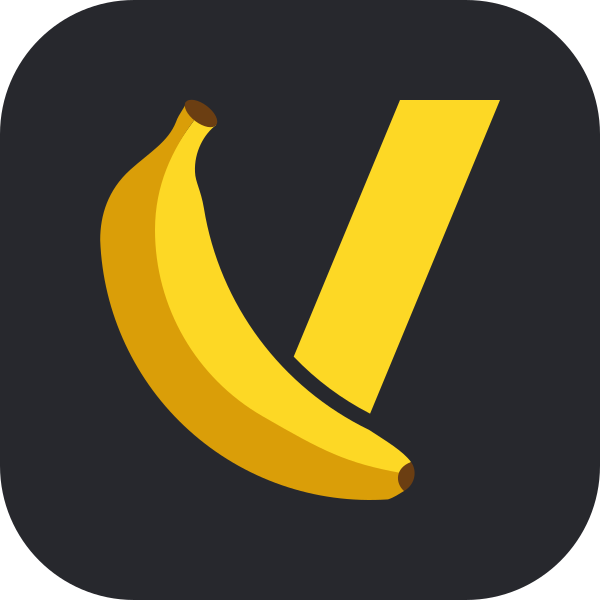
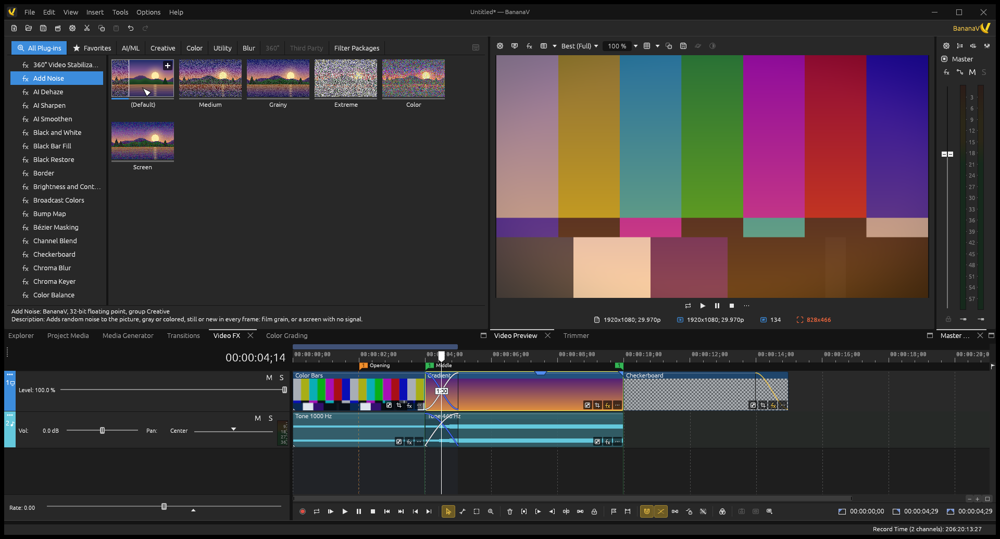

<p align="center">
  <picture>
    <source media="(prefers-color-scheme: dark)" srcset="docs/brand/bananav-logo-transparent.svg">
    <source media="(prefers-color-scheme: light)" srcset="docs/brand/bananav-icon.svg">
    
  </picture>
</p>

<h1 align="center">BananaV</h1>

<p align="center">
  <strong>A free and open-source video editor for Windows and Linux, written in Rust.</strong>
</p>

<p align="center">
  <a href="LICENSE"></a>
  <a href="https://github.com/acasoq-web/BananaV/actions/workflows/ci.yml"></a>
  <a href="https://discord.gg/vtC7Yasz98"></a>
  <a href="https://github.com/acasoq-web/BananaV/releases"></a>
</p>

<p align="center">
  <a href="#download">Download</a> ·
  <a href="#features">Features</a> ·
  <a href="#building-from-source">Build</a> ·
  <a href="#contributing">Contribute</a> ·
  <a href="CHANGELOG.md">Changelog</a> ·
  <a href="#support-the-project">Support</a>
</p>

<p align="center">
  
</p>

BananaV is a non-linear video editor built around a track-based timeline:
events on video and audio tracks, envelopes and keyframes, effects at every
level (media, event, track and output), and a workflow you can drive from the
keyboard. It is written from scratch in Rust: its compositing, audio mixing,
color management and most of its file formats are its own code, and the
interface speaks English and Brazilian Portuguese.

> **Early development.** BananaV has not reached 1.0: expect missing features
> and rough edges, and save often. See the [roadmap](docs/ROADMAP.md) for what
> is done and what comes next, and the [changelog](CHANGELOG.md) for what
> changed in each build.

## Download

Get the latest version from the
**[Releases page](https://github.com/acasoq-web/BananaV/releases)**:

| System | Package | How to run |
|---|---|---|
| Windows 10 or 11 (x64, ARM64) | `BananaV-…-windows-x64.zip`, `…-windows-arm64.zip` | Unzip and run `BananaV.exe`: nothing to install. |
| Linux, glibc 2.35 or newer (x64, ARM64) | `BananaV-…-linux-x64.AppImage`, `…-linux-arm64.AppImage` | `chmod +x` the AppImage and run it. |

You need a graphics card with Direct3D 12, Vulkan or OpenGL. Each package has
a README with the details and the licenses of what it includes.

## Features

- **Editing** — video and audio tracks with events you move, trim, split,
  slip and slide; ripple editing; fades and crossfades with a choice of
  curves; groups, takes and multicamera editing; markers, regions and a
  loop region; edge trimming; a full undo history.
- **Video** — effect chains on media, events, tracks and the output; Pan/Crop
  and track motion with keyframes, in 2D or 3D; compositing modes and parent
  tracks; masks; motion tracking and stabilization; slow motion and motion
  blur by optical flow; transitions (62 from the GL Transitions collection
  among them), titles and text, generated media.
- **Effects** — about 120 video effects, transitions and generators of
  BananaV's own (blurs, color, light and film looks, lens correction, mesh
  warp, 360° video, AI/ML-style smoothing, sharpening and dehazing…), most
  of them drawn on the graphics card.
- **Color** — a color grading panel (wheels, curves, HSL, LUTs), video scopes,
  and ACES 1.3 color management through BananaV's own OpenColorIO
  implementation.
- **Audio** — a mixing console with busses and assignable effect chains,
  volume, pan and effect automation, 5.1 surround panning, auto ducking,
  loudness meters (EBU R 128), beat and tempo detection.
- **Plug-ins** — an OpenFX 1.5 host for video effects, transitions and
  generators, and a VST 3 host for audio effects. BananaV's own video effects
  are OpenFX plug-ins too, also built as `BananaV.ofx` for other OpenFX hosts.
- **Media** — most video and audio through the system's codecs (Media
  Foundation on Windows, FFmpeg on Linux), decoded and encoded on the graphics
  card when it can; BananaV's own code for PNG, JPEG, TIFF, OpenEXR, DPX,
  Photoshop documents, WAV, Wave64, AIFF, FLAC and ProRes.
- **Rendering** — MP4 and MOV (H.264, HEVC, AV1, ProRes, with the encoders
  the computer has), image sequences and audio files; compositing on the
  graphics card (through wgpu: Direct3D 12, Vulkan or OpenGL) with the
  processor as the fallback.
- **Interchange** — EDL, Final Cut Pro 7 XML and FCPXML, and OpenTimelineIO
  (`.otio`, `.otioz`, `.otiod`).
- **Discs and capture** — DVD-Video authoring and burning, Video CDs and audio
  CDs, with BananaV's own MPEG-2 and MPEG-1 encoders; screen capture of
  displays, windows, cameras and the computer's sound.
- **Workspace** — dockable windows and saved layouts, customizable keyboard
  shortcuts, four interface color schemes from dark to white, English and
  Brazilian Portuguese.

## Building from source

You need Rust 1.95 or newer. On Linux, also ALSA's and FFmpeg's development
files (on Ubuntu: `libasound2-dev pkg-config libclang-dev libavcodec-dev
libavformat-dev libavutil-dev libswscale-dev libswresample-dev`).

```bash
git clone https://github.com/acasoq-web/BananaV.git
cd BananaV
cargo run --release -p bananav
```

[CONTRIBUTING.md](CONTRIBUTING.md) has the details for Windows and Linux and
the checks every change passes (`cargo xtask ci`).

### Repository layout

| Folder | What is there |
|---|---|
| `apps/bananav` | The application |
| `apps/ofx-bundle` | BananaV's effects as `BananaV.ofx`, for other OpenFX hosts |
| `crates/core` | Time in ticks (254,016,000,000 per second), rates, frames |
| `crates/timeline` | The project model, editing, undo, interchange |
| `crates/media` | Media sources: files and generators |
| `crates/render`, `crates/gpu` | Video compositing on the processor and on the graphics card |
| `crates/mixer` | Audio mixing, envelopes, meters |
| `crates/engine` | Playback, preview, rendering |
| `crates/ui-egui` | The interface, and its translations in `src/i18n` |
| `crates/effects` | BananaV's own video effects, as OpenFX plug-ins |
| `crates/…` | File formats, codecs, color management and plug-in hosts written for BananaV |
| `xtask` | The checks: formatting, layer rules, lints, tests, WebAssembly build |

Each crate belongs to a layer and depends only on lower layers;
[CLAUDE.md](CLAUDE.md) describes the architecture.

## Contributing

Contributions are welcome: bug reports, ideas, translations, tests and code.

1. Read **[AGENTS.md](AGENTS.md)** — the project's rules, for people and AI
   agents alike: never crash, open or original assets only, clean-room code.
2. Follow **[CONTRIBUTING.md](CONTRIBUTING.md)** — building, `cargo xtask ci`,
   commits signed off under the Developer Certificate of Origin.
3. Be kind: everyone follows the [Code of Conduct](CODE_OF_CONDUCT.md).

Found a bug or have an idea? Open an
[issue](https://github.com/acasoq-web/BananaV/issues/new/choose). Found a
security problem? Report it privately, as [SECURITY.md](SECURITY.md) says.

## Support the project

BananaV is free, and it stays free. If it is useful to you, you can help it
grow:

<p align="center">
  <a href="https://ko-fi.com/bananav"></a>
  <a href="https://pixgg.com/Acaso"></a>
  <a href="https://discord.gg/vtC7Yasz98"></a>
  <a href="https://bananav-editor.github.io/"></a>
</p>

- **Donate** on Ko-fi, from any country, or with PIX, from Brazil, to pay
  for the project's time, machines and services.
- **Join the community** on Discord: get help, share what you made, talk
  about what comes next.
- **Visit the website** for news and guides.
- **Spread the word**, star the repository, and
  [contribute](#contributing).

## License

BananaV is free software: you can redistribute it and/or modify it under the
terms of the **GNU General Public License as published by the Free Software
Foundation, either version 3 of the License, or (at your option) any later
version** ([LICENSE](LICENSE), SPDX `GPL-3.0-or-later`). It comes with
ABSOLUTELY NO WARRANTY.

- Third-party code, fonts and data in BananaV keep their own licenses, all
  compatible with the GPL: see [ATTRIBUTION.md](ATTRIBUTION.md).
- The name "BananaV" and its logo identify the official project: see
  [TRADEMARKS.md](TRADEMARKS.md).
